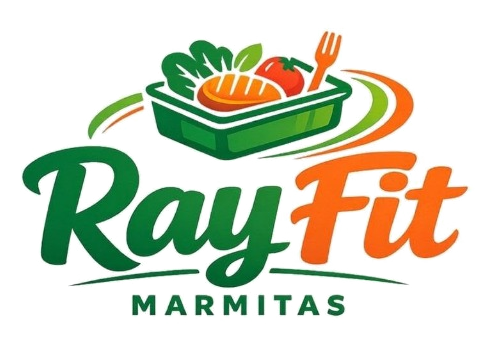

# RayFit Web — Experiência Digital Imersiva 2026

<div align="center">
  
  
  <p align="center">
    <strong>Alimentação Saudável & Alta Performance com Apresentação Visual Futurista</strong>
  </p>

  <p align="center">
    <a href="https://ronaldodevbackend.github.io/RayFit-Web/">
      
    </a>
  </p>

  <p align="center">
    
    
    
    
    
  </p>
</div>

---

## 📌 Visão Geral do Projeto

Esta aplicação web foi meticulosamente projetada e desenvolvida para um cliente corporativo do segmento de alimentação saudável e fitness, tendo como propósito central **apresentar o catálogo de produtos da RayFit de maneira extremamente elegante, limpa e tecnológica**.

Inspirada nas mais modernas tendências de web design de 2026 (design espacial, profundidade 3D em perspectiva e microinterações táteis), a página abandona layouts tradicionais com sobrecarga de informações e foca em uma experiência fluida de apenas **duas seções principais** com transição contínua em degradê aveludado e uma **splash screen introdutória cinematográfica**.

---

## ✨ Principais Funcionalidades

- **Splash Intro Cinematográfica (A Marmita da Logo Se Formando)**:
  - Ao acessar o site, a **marmita oficial da RayFit** inicia sua montagem imediatamente de primeira em animação vetorial fluida com iluminação difusa:
    - *Tigela verde isométrica*, *folhas verdes frescas*, *tomate*, *filé grelhado com listras tostadas*, *garfo laranja dinâmico*, *arcos de energia em espiral* e *revelação do lettering RayFit com feixe de luz*.
  - Abertura suave em dissolução cinematográfica para o site principal.
  - Botão flutuante permanente para rever a introdução a qualquer momento.

- **Vitrine em Órbita 3D Circular (Agrumea Concept)**:
  - Carrossel cilíndrico tridimensional com cálculo trigonométrico em tempo real.
  - Cada marmita orbita em perspectiva `preserve-3d`, simulando profundidade e reflexo realistas.
  - O disco curvo ao fundo e o anel tipográfico rotativo adaptam suas cores dinamicamente conforme o produto ativo.

- **Navegação Multicanal & Dinâmica de Touch em Dispositivos Móveis**:
  - **Física de Touch em Tempo Real**: no celular e tablet, o carrossel responde instantaneamente ao movimento do polegar durante o arraste (`touchmove`), aplicando rotação e inércia realistas.
  - **Clique Direto (`onclick`)**: clique nas marmitas laterais para girar o carrossel na direção desejada.
  - **Scroll do Mouse (`wheel`)**: navegação contínua através do scroll do mouse com controle de inércia.
  - **Controles de Seta e Paginação**: botões circulares em vidro fosco (*glassmorphism*) e teclado (setas esquerda/direita).

- **Logo Orgânica, Centralizada & Reativa**:
  - Imagem transparente recortada com precisão anti-aliased, em grande escala e total evidência.
  - Aura luminosa pulsante e flutuação contínua (`organicFloat`).
  - Efeito Parallax / Tilt 3D reativo baseado na posição do cursor do mouse.

- **Transição Aveludada em Degradê**:
  - Transição de cores fluida entre a Div 1 e a Div 2, eliminando qualquer linha dura ou corte seco entre as telas.

- **Microinterações & Conversão Direta**:
  - Botão interativo *"Descobrir o Produto"* na marmita ativa com ponto luminoso pulsante.
  - Modal dinâmico (com adaptação para *bottom sheet* no mobile) exibindo tabela nutricional completa e botão de pedido direto via **WhatsApp** com mensagem pré-formatada.

---

## 🛠️ Tecnologias Utilizadas

- **HTML5 Semântico**: Estrutura focada em acessibilidade, semântica limpa e alta performance.
- **CSS3 Moderno**: 
  - CSS Custom Properties (Variáveis temáticas).
  - Espaço tridimensional com `perspective`, `transform-style: preserve-3d` e aceleração por GPU.
  - Unidades `dvh` e `svh` para evitar que barras de navegação mobile cortem o conteúdo.
  - Efeitos de *glassmorphism* com `backdrop-filter`.
  - Design 100% responsivo para Mobile compacto, Smartphones, Tablets, Laptops e Desktops 4K.
- **JavaScript Vanilla (ES6+)**:
  - Zero dependências ou frameworks pesados.
  - Rotação cilíndrica com wrapping circular contínuo.
  - Detecção de gestos de toque com cálculo dinâmico de offset e inércia.

---

## 📂 Estrutura de Arquivos

```bash
RayFit/
├── assets/
│   ├── css/
│   │   └── style.css              # Folha de estilos externa com regras responsivas e splash intro
│   ├── images/
│   │   ├── logo-rayfit.png        # Logo transparente recortada e otimizada
│   │   ├── logo-rayfit.jpg        # Imagem original de referência
│   │   └── marmitas/              # Renders em alta definição dos produtos
│   │       ├── marmita-1.png
│   │       ├── marmita-2.png
│   │       ├── marmita-3.png
│   │       ├── marmita-4.png
│   │       └── marmita-5.png
│   └── js/
│       └── main.js                # Lógica da intro, carrossel 3D e física touch
├── index.html                     # Estrutura principal da página
├── generate_assets.py             # Script de processamento gráfico de assets
└── README.md                      # Documentação oficial do projeto
```

---

## 🚀 Como Executar o Projeto

Como o projeto é construído em JavaScript e CSS puros, nenhuma instalação ou build complexo é necessário:

1. Clone o repositório:
   ```bash
   git clone git@github.com:RonaldoDevBackEnd/RayFit-Web.git
   ```

2. Acesse a pasta do projeto:
   ```bash
   cd RayFit-Web
   ```

3. Abra o arquivo `index.html` em qualquer navegador moderno (Chrome, Edge, Firefox, Safari):
   ```bash
   # Exemplo no Windows (PowerShell):
   Start-Process index.html
   ```

---

## 👨‍💻 Desenvolvedor

Projeto concebido e desenvolvido por:

**Ronaldo Adriano**  
- **GitHub**: [@RonaldoDevBackEnd](https://github.com/RonaldoDevBackEnd)  
- **Email**: [ronaldo.adrianof.dev@gmail.com](mailto:ronaldo.adrianof.dev@gmail.com)

---

<div align="center">
  <sub>Desenvolvido com excelência visual, foco em alta conversão e inovação. © 2026 RayFit.</sub>
</div>
